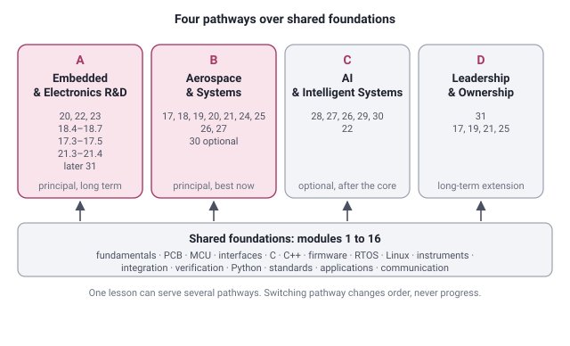

# Career pathways and evidence-based recommendations

Specification, 2026-11-06. This document defines the next platform increment; it does not claim that four-pathway recommendations already exist. The shared [subject matrix](ENGINEERING_COVERAGE.csv) and [batch plan](ENGINEERING_IMPLEMENTATION_PLAN.md) are the syllabus contract.

## Four routes through shared subjects

| Pathway | Career direction | Shared foundations and sequence | Demonstrable exit task, not a qualification |
|---|---|---|---|
| A — Embedded and Electronics R&D | Firmware, embedded systems, electronics/hardware R&D | Circuit laws, C, measurement → P0-1 tools/test/debug → P0-2 peripherals and drivers → P0-3 real-time → P0-4 circuit/PCB design → P0-5 integration; P1-1 C++/Linux as role requires | Implement, bring up and debug the existing sensor-monitor product; retain schematic, build, tests and raw traces; distinguish simulated from measured results |
| B — Aerospace and Systems Engineering | UAV/aircraft systems, avionics integration and V&V, architecture | Same P0 core → P1-2 architecture/links → P1-3 dynamics/control/estimation → P1-4 assurance and HIL; deepen existing test/FMEA/ICD subjects | Defend an educational DFCC architecture, bus schedule, fault campaign and requirements/evidence argument with explicit model limits |
| C — AI and Intelligent Systems | AI-enabled embedded products, edge inference and autonomy | Same C/Python/test core → mathematics, acquisition and P1-3 estimation → P2-1 ML/edge inference → P2-2 simulation/autonomy/AI assurance | Evaluate a public or synthetic sensor model against a non-ML baseline; measure resource/latency limits and failure cases; no flight-use inference |
| D — Engineering Leadership and Technical Product Ownership | Systems architecture, technical leadership and evolving product responsibility | Same evidence-producing P0 project → requirements, interfaces, review and release practice → P1 system trade-offs → P2-3 stakeholder/cost/lifecycle/roadmap ownership | Lead a reviewed change from stakeholder need through feasibility, architecture, BOM, verification and controlled release; demonstrate decisions and follow-through over time |

**Principal direction.** Pathways A (embedded and electronics R&D) and B (aerospace and systems engineering) are the principal long-term direction; verification and validation is an important specialisation within B and a practical near-term route, not the only destination. Advanced module membership per pathway is in [ADVANCED_MODULE_CROSSWALK.md](ADVANCED_MODULE_CROSSWALK.md).

One canonical subject/lesson id can serve multiple paths. Switching career goal changes ordering, never copies a lesson, resets evidence or awards a role. The future-technology pathway is optional after its core prerequisites. Product responsibility grows with reviewed work and experience; finishing a pathway does not make someone a product owner, architect or flight-safety authority.

## Pathway organisation for the learner



| | Shared foundations | Pathway-specific advanced modules | Status for this learner |
|---|---|---|---|
| **A Embedded and Electronics R&D** | 1, 2, 3, 5, 7, 8, 10, 11 at Apply or Master; the rest at Understand | 20, 22, 23; 18.4 to 18.7; 17.3 to 17.5; 21.3 to 21.4; 31 later | Principal long-term direction |
| **B Aerospace and Systems Engineering** | all 16 at Understand, 4, 10, 11, 12 at Apply | 17, 18, 19, 20, 21, 24, 25; 26 and 27 when the role needs control and estimation; 30 optional | **Best pathway now** (builds on existing avionics integration and verification experience) |
| **C AI and Intelligent Systems** | 5, 13 and the P0 core | 28, 27, 26, 29, 30; 22 | Long-term extension, optional, after the core |
| **D Engineering Leadership and Technical Product Ownership** | 11, 12, 16 | 31; 17, 19, 21, 25 | Long-term extension; grows through reviewed work on the shared product |

The detailed per-module description is in [FULL_CURRICULUM_MAP.md](FULL_CURRICULUM_MAP.md); the personal route in [SUSHMITA_CAREER_SWITCH_GUIDE.md](SUSHMITA_CAREER_SWITCH_GUIDE.md); "which modules are essential for my role" in [LEARNER_GUIDE.md](LEARNER_GUIDE.md). Verification and validation is an important specialisation inside Pathway B and a practical near-term route; it is not the only destination.

## What counts as evidence

Keep **learning activity**, **task performance** and **engineering evidence** distinct:

- Activity: reading, time on a step, lesson completion, depth selection, hint use, portfolio ticks and interview self-ratings. Useful for navigation and teaching evaluation; cannot demonstrate professional capability.
- Task performance: first unassisted response to a graded, unseen exercise or evidence-backed mission. Supports the specific skill tested. Repeating a known answer or opening the expected output is not independent performance.
- Engineering evidence: retained source/configuration, build command and tool versions, raw logs/captures, tests including negative cases, design rationale and review feedback. Record whether this is learner-reported, reproduced by automation or reviewed independently. Automated checks only establish what those checks test.

Suggested evidence record for the future implementation:

```text
skillId, taskId, artifactRef (device-local descriptive reference), artifactRevision,
mode (host | simulation | hardware), toolVersions,
verification (learner-reported | reproduced | reviewed),
outcome (passed | failed | needs-review), observedAt, reviewerNote?
```

No personal résumé data, customer identifiers, employer artifacts or arbitrary artifact contents are uploaded. Prefer local evidence records and the existing user-controlled backup. Public examples stay synthetic/public. A future submission/review service needs its own privacy design; it is not part of this specification.

## Current recommendation audit

`lib/progress/recommend.ts` uses retries, shared skill/module, shaky interview ratings, completed lessons before missions, and untouched modules. `lib/progress/diagnostic.ts` maps wrong answers to foundation lessons. Neither records career objectives or verified artifact evidence. `lib/progress/readiness.ts` can call a module “evidence complete” partly from confident interview ratings; this is an **activity summary**, not proof of competence. Do not reuse that state as a skill-pass signal for pathways.

## Recommendation contract

Inputs: an optional explicit career goal (A/B/C/D, allow multiple), canonical skill/task metadata, prerequisite graph, graded attempt/mission evidence, artifact records, and learner constraints such as board availability. All are local and optional. Missing legacy fields mean **unknown**, not failed or passed.

Algorithm, deterministic and explainable:

1. With no goal, offer the four goals and a skippable short diagnostic. Offer a shared foundation task in the meantime; never infer a career preference from a name, résumé, demographics or location.
2. For the selected goal, select canonical tasks in priority order P0 → P1 → P2. P2 remains opt-in even when the goal is C. A learner may inspect any lesson; prerequisites advise rather than lock access (ADR-15).
3. Build the prerequisite closure for each candidate. An absent, cyclic or unknown metadata reference is an authoring error. An unsupported prerequisite has evidence state “not yet demonstrated”; recommend the earliest available prerequisite task. If that task is unimplemented, show a planned task honestly and offer a published alternative, not a broken link.
4. Within applicable prerequisites, prioritize unresolved failures in core skills, then an independent task after guided work, then missing evidence. A correct repeated exercise and a confident self-rating never erase a failed independent lab. Reused artifacts count only for the skills and revisions actually assessed.
5. Select one next action and at most two alternatives. Prefer available host/simulation work when hardware is unavailable, while keeping hardware evidence explicitly outstanding. Do not silently equate host arithmetic with STM32 operation or a model with HIL.
6. Explain the decision with facts: “You chose Embedded R&D. Your UART task has an untested timeout path. Run the fake-port timeout case; the board test can follow.” Show missing prerequisites and the evidence needed to change the recommendation. Do not produce mastery percentages, job-readiness guarantees or a single rank across professions.
7. On goal changes or new evidence, recompute ordering; preserve existing lesson/exercise ids, progress and artifact provenance. A changed artifact/test revision requests recheck for affected skills rather than deleting earlier evidence.

If the learner skips diagnostics, start from a selected practical entry task and permit correction. For experienced learners, use an optional unseen performance task; self-described experience changes suggested entry, not skill-pass evidence. When goals conflict, share prerequisites first and let the learner choose the next branch.

## Storage and interface acceptance

- Additive optional fields only, with explicit validation and import/export tests for existing 0.1/1.0 backups. Do not bump store version merely to add optional fields; use a migration if the actual shape requires one. Bound record sizes and validate timestamps and ids.
- Add a pathway choice and a plain-language next-task card using existing UI controls; no new global teaching conversion. The current journey remains separately reachable. Missing, shallow and pending content are labelled; recommendations link only to published slugs or to an explanatory plan view.
- Keyboard and screen-reader access, focus after selection, honest empty states, mobile tap targets and axe checks on mobile/desktop are required. Copy must explain evidence provenance without exposing implementation details.
- Avoid naming the UI depth `master` as proof of mastery. Show “completed at Master depth” as activity; a skill record says what task was demonstrated, how and under which conditions.

## Implementation acceptance cases

| Case | Required behavior |
|---|---|
| New learner, no goal or evidence | Shared foundation recommendation; skippable goal/diagnostic; no invented level |
| A goal, missing C prerequisite, strong interview self-rating | Recommend a C performance task; confidence cannot bypass prerequisite evidence |
| Guided solve with hints | Offer an unseen independent variant; do not label demonstrated engineering competence |
| Lab fails despite all lessons complete | Show the failing case and diagnostic next step |
| Host model passes, hardware absent | Record host evidence only; optional hardware task remains pending |
| B and C goals share estimation | One canonical estimation task and evidence record |
| Unimplemented advanced prerequisite | Honest planned state and usable published alternative |
| Goal switch and backup round-trip | Preserve all prior activity and evidence; recompute recommendations |
| Changed artifact revision or incompatible test revision | Retain history and request scoped revalidation |
| Self-reported artifact without independent review | Display provenance; no automatic competence claim |

Implement these meaningful policy and browser tests with the feature. This documentation increment does not add tests that merely mirror prose.
