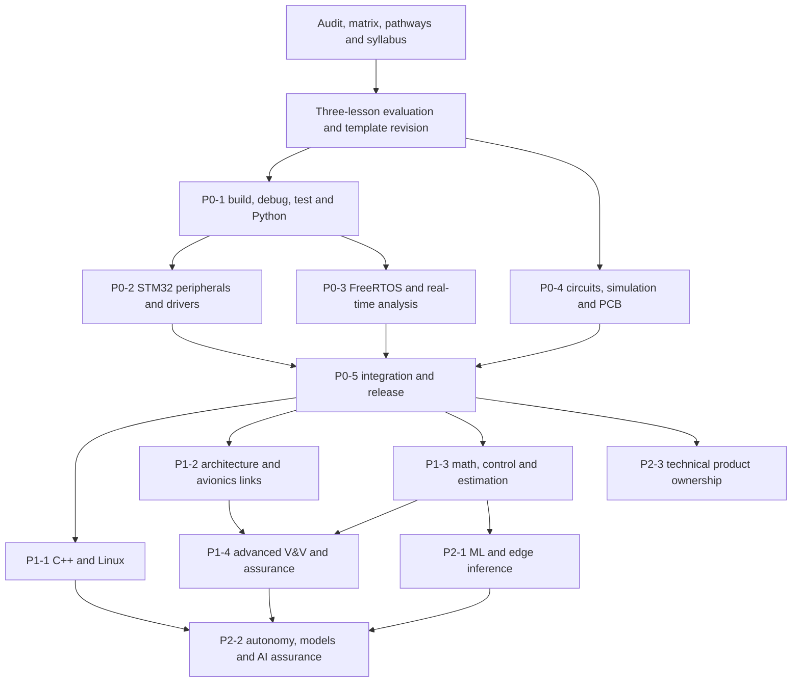

# Prioritized engineering implementation plan

2026-11-06. [Audit](ENGINEERING_GAP_AUDIT.md), [subject matrix](LEARNING_COVERAGE_MATRIX.md), [per-subject task/evidence contracts](ENGINEERING_COVERAGE.csv), [pathways](CAREER_PATHWAYS.md). Proposed lesson titles below are scope envelopes, not quotas or playable content. Combine adjacent objectives when that improves learning. Preserve existing slugs, exercise/lab ids and portfolio stages.

## Current delivery and gates

This documentation batch is implemented. P0 curriculum expansion is **not started**: pilot findings remain pending, and the request conditions implementation on approved P0 scope and a learner-validated format. P1/P2 remain sequenced plans.

1. Reuse the stack: #11 release record → #12 original audit → #13 prerequisites/diagnostic/labs → #14 fundamentals → #15 C/STM32 → #16 pilot. Review actual diffs and re-run checks on retargeted merge results. This planning request does not authorize merging or production deployment.
2. Evaluate the three pilot lessons. Record neutral confusing-step/terminology findings, guided versus independent performance, observed explanation/debugging where available, approximate duration and uncertainty in `PILOT.md`. No questionnaire is required. Dwell time and self-ratings suggest issues but do not prove learning. Keep personal exports outside public source.
3. Adjust `CONTENT_AUTHORING.md` from those findings and approve the first small P0-1 slice. No fourth pilot or academy-wide conversion before this gate.
4. Accept a slice only after applicable checks and learner findings are addressed. If learning fails, revise that slice before broadening rollout.

## Dependencies

P0-4 may begin after pilot approval and #14 circuit/DMM foundations, without waiting for firmware. P0-2 and P0-3 share P0-1. P1-3 teaches math before control/estimation. P2-3 requires reviewed architecture and sustained responsibility; it is not an automatic graduation step. Advanced module ids are reconciled in [ADVANCED_MODULE_CROSSWALK.md](ADVANCED_MODULE_CROSSWALK.md): 17–25 original, 26–31 new.

## P0 — Immediate practical engineering and employability

| Slice | Lessons and reuse | Lab/design task | Assessment and exit evidence | Dependencies |
|---|---|---|---|---|
| P0-0 | Audit, syllabus and pathway specification; existing three-lesson pilot. Pathway recommendation implementation is a separate reviewed feature | Observe power-tree, priority-inversion and 1553 pilot; reconcile prior advanced proposal | Recorded findings/template changes and agreed first content slice; no new competence claim | Open stack reviewed; learner pilot use |
| P0-1a | Build/test one C module; Git for a firmware project; Python for the test bench. Reuse `c-functions`, `c-elapsed`, `c-bits`, `py-bytes-str` and portfolio build-it; reuse old E/F/G plans | Clean-checkout Make/CMake build; header/source split; CSV parser and parametrized tests; intentional defect/CI failure | Learner edits implementation, predicts/runs/tests, diagnoses unseen boundary fault; retained source, tool versions and command; negative tests catch defects | #15 C/pointer/fixed-width foundation; host compiler/Python setup |
| P0-1b | GDB from crash to faulty line; linker/map files; bounded interfaces and static analysis; layers/test seams. Reuse startup/memory/state-machine lessons | Host GDB fault transcript; educational cross-linked ELF and section assertions; warning/sanitizer/static-analysis exercise; fake HAL | Failing-before/passing-after regression, fault location and memory budget; linker overflow detected; findings reviewed. MISRA awareness, no compliance claim | P0-1a; startup/memory foundations; ARM cross-toolchain for target ELF slice |
| P0-2a | ADC sampling/calibration; timers/PWM/input capture; DMA ownership and bounded interrupts. Extend first-STM32/GPIO/clock/NVIC work | Fake-peripheral harness; sampling model; timer wrap; late-consumer DMA; optional Nucleo execution | Register/config reasoning, driver source, raw trace/error budget, timeout/overrun tests. Cross-build before claiming built; board evidence separate | P0-1; clock/GPIO/NVIC prerequisites |
| P0-2b | A bounded driver contract across UART/SPI/I2C/CAN; watchdog supervision, reset diagnosis and low power. Reuse protocol/ring lessons | NACK/stale reply/timeout/overflow/bus-off injection; optional loopback/capture; heartbeat fault | Unseen driver fault fixed and regression added; latency/retry bound; ring atomicity/compiler ordering reviewed; hardware record includes board and firmware | P0-2a; protocol foundations |
| P0-3a | Tasks/scheduler/tick → synchronization and ownership → pilot inversion; deadlock/lock ordering. Reuse old E proposals | Deterministic scheduler/lock model; optional FreeRTOS handoff application | Predict task states, remove circular wait, justify primitive; overflow/lost-data cases; model clearly distinguished from RTOS port | P0-1; state machines and interrupts |
| P0-3b | Periods/deadlines, blocking/interference/jitter and worst-case response analysis | Response-time calculator plus schedulable/overloaded traces; optional GPIO timing | Intermediate calculations, workload assumptions and discrepancy analysis; explain why average CPU load cannot prove deadlines | P0-3a; timers and priorities |
| P0-4a | Signal conditioning, digital logic timing, power/thermal/protection, DAC versus PWM, calibration and component selection. Extend #14 and power-tree pilot | Hand calculations → LTspice RC/op-amp/switch sweeps; synthetic calibration; KiCad sensor schematic | Independent tolerance/headroom budget, source/model provenance, unseen saturation/protection fault diagnosis | #14 laws/components/RC/logic/DMM; pilot gate |
| P0-4b | Layout/returns/SI; EMC basics; KiCad to fabrication; DFM/DFT/test access. Reuse old layout/tool proposals | Two-layer board; ERC/DRC; Gerbers/drill/BOM; annotated ESD/return paths; jig/test-point plan | Reviewable source, explained ERC/DRC exceptions, manufacturing/test findings and closure. Simulation is not measured SI/EMC qualification | P0-4a; probing fundamentals |
| P0-5a | Requirements/acceptance → partition/block/timing/power architecture → ICD → integrated firmware → bring-up/calibration | Extend the existing seven-stage `stm32-sensor-monitor`, detection harness and sensor model; bus/data/power faults; optional board | Requirements/test links, golden frames, raw data, timed fault logs, expected/observed comparison and independent review; hardware/simulation separate | Relevant P0-1/2/3/4 artifacts |
| P0-5b | Serial/SCPI/PyVISA automation, reports/pytest, production-test screen, reproducible release/change, concise coding/career communication | Reuse fake port/SCPI simulator; missing/late/corrupt data; clean release/rollback; qualification plan | Report reproducible from raw data, independent negative tests, versioned release/config evidence and honest portfolio narrative. Apply for jobs without waiting for P1/P2 | P0-5a; Python/Git tools and existing communication lessons |

The CSV uses parent batch ids P0-1…P0-5 so references remain stable if slices split further. First proposed content slice: **P0-1a's single C-module build/test task**, specified lesson by lesson in [P0-1A_FIRST_LESSON.md](P0-1A_FIRST_LESSON.md), not this whole table at once.

## P1 — Advanced aerospace and broader firmware

| Batch | Lesson clusters | Labs and assessment evidence | Dependencies |
|---|---|---|---|
| P1-1 | Embedded C++ classes/references/RAII/templates/interfaces/dispatch and target debug; Linux shell/process/logs, boot/device tree/BSP, cross-build and driver fundamentals. Deepen modules 6/7/9 | Compiled guard/mock-driver tests and resource comparison; public emulator image and boot failure; educational probe/remove failure exercise. Keep kernel experiments in emulator | P0 build/debug/driver evidence; not dependent on all aerospace topics |
| P1-2 | Aircraft/UAV/DFCC architecture, redundant/fault-tolerant systems, cross-channel voting and real-time avionics; 1553 schedules/faults and ARINC 429. Preserve pilot as 1553 foundation | Block/ICD/timing budgets; voter fault campaign including stale data/common cause; scheduled bus simulator and golden-word decoders; sourced protocol assumptions | P0 integration, protocols and timing; modules 18 and 19 per [the crosswalk](ADVANCED_MODULE_CROSSWALK.md) |
| P1-3 | Engineering math first; basic flight dynamics/frames; plant/feedback/PID/anti-windup/stability; IMU/GNSS/air-data processing/fusion; Kalman predict/update | Hand intermediates reproduced in Python; first-order plant then simplified pitch-rate loop; known-truth noise/bias/dropout; error/lag/residual/divergence analysis | Algebra/units → vectors/matrices/probability → signals/control/estimation; P0 acquisition/Python/tests |
| P1-4 | Preserve/deepen advanced V&V: requirements/robustness/structural coverage, independence/configuration; ARP4754A/ARP4761 concepts; DO-178C/254/160 scope/application; FMEA/common cause; SIL/PIL/HIL/qualification | Educational hazard/allocation/test argument; timed integration/fault campaign; coverage/model-validity review; optional physical HIL with target/instrument provenance; standards claim ledger | P1-2/3; traceability and fault-analysis artifacts; exact standards requirements independently verified |

## P2 — Optional specialization and evolving ownership

| Batch | Lesson clusters | Labs and assessment evidence | Dependencies |
|---|---|---|---|
| P2-1 | ML fundamentals/baselines/splits/leakage, TinyML/edge inference/quantization, anomaly detection/predictive maintenance; AI-assisted firmware, generated tests and engineering analysis | Public/synthetic data, held-out non-ML baseline, accuracy/memory/latency measurements, false-alarm/missed-fault/drift analysis; review generated code/test oracles against independent requirements | Core implemented/tested code and acquisition; P1-3 math/signals; explicit optional AI choice |
| P2-2 | Embedded vision/autonomy; ROS 2/QoS/frames, PX4/ArduPilot simulation; MATLAB/Simulink and model-based design concepts, digital twins, AI-enabled assurance | Pinned isolated software simulation; dropout/frame/time faults; public vision failure cases; solver/model/code comparison; twin calibration versus held-out validation; ODD/data/model/runtime-monitor assurance gaps | Relevant Linux, controls, architecture, P2-1 and assurance evidence. Open Python alternative for licensed tools; no flight-use or certification inference |
| P2-3 | Stakeholder/customer problem, measurable acceptance, feasibility/partitioning/trade-offs, BOM/cost/supply risk, reliability/maintainability/lifecycle, reviews/roadmaps/priorities, leadership and release ownership | Extend existing product: synthetic discovery brief, competing designs, dated BOM assumptions, service/change plan, cross-functional review/actions and controlled release. Review decision quality and follow-through over multiple changes | Reviewed P0 product and architecture trade-offs; P1 as product needs. Role responsibility develops over time; no automatic qualification |

## How a slice is judged

A slice is accepted on four kinds of evidence, never on the number of lessons it adds:

1. **Learning effectiveness.** The pilot record (`PILOT.md`) for the lessons in the slice: what the learner understood, where she struggled, and whether she solved the unseen independent task. A slice whose independent task fails is revised before anything broader is written.
2. **Practical engineering evidence.** The retained artefacts the slice's acceptance test names (source, build command and tool versions, test log with a negative case, trace or transcript), reproduced by CI where a host can do it and labelled host, simulation or hardware.
3. **Prerequisites.** Every lesson declares its prerequisites; the slice does not depend on an unpublished one without a published alternative; the depth tags give a playable lesson at every depth.
4. **Career relevance.** Each lesson's "where you will use this" step names the role families it serves, and the slice maps to pathway rows in the CSV. Content that cannot name its use is not scheduled.

## Authoring and assessment contract

After pilot validation, each new subject uses the adjusted Understand → Apply → Master arc: practical reason → simple intuition before terminology → useful visual/code walkthrough → worked example with important intermediate steps → meaningful guided hints → independent application/debugging → realistic engineering problem → answer-specific misconception feedback → jobs/product relevance. Reuse the nine-stage schema and current ≤220-word concept limit unless learner findings justify a change. Lesson counts are not success criteria.

Understand tests prediction/explanation at a narrow scope. Apply requires changed inputs, code/design or diagnosis. Master depth adds failure modes/limits/trade-offs; it is not a mastery credential. Every practical batch includes an unseen independent variant, not copying a walkthrough or expected output. Artifact provenance distinguishes learner report, automated reproduction and independent review. No public personal résumé/employer content.

For normative standards claims record document, edition, clause/objective, authorized source, applicability and technical reviewer. If unavailable, label a scope summary or simplified educational model; avoid “the standard requires.” No invented qualification limits. A passing host/SIL/HIL/AI lab never establishes flight safety.

## Applicable gates before each batch is accepted

| Gate | Required check/evidence |
|---|---|
| Unit/policy/storage | `npm test`; meaningful new grading/recommendation/prerequisite/evidence tests where changed; old backups import/export; depth/hint semantics preserved |
| Runnable lab | Existing manifest/source/generated-output tests rebuild/run; negative/known-failing case proves harness detects defects; independently check expected numbers instead of merely regenerating them |
| Content/technical review | Schema/cross-reference/prerequisite/arc checks; misconception feedback and sources; synchronized `CONTENT_REVIEW.md`; independent technical reader and standards ledger as applicable |
| Target/electronics | Specified MCU/toolchain compile/link before build claims; physical board for flash/run claims. Circuit/PCB versions, model sources, ERC/DRC/netlists/outputs and review. Missing board/licence is a blocked gate or explicitly simulation-only scope |
| Browser/accessibility | Changed flows and regressions on Pixel 7/desktop Chrome using Playwright/axe; keyboard/focus/labels/tap targets, depth/hints/resume and honest completion/provenance. Runtime-free docs: not applicable, record reason |
| Build/preview | Lint, typecheck, production build/route checks for app/content changes; inspect exact proposed merge preview |
| Learner evaluation | Neutral slice findings incorporated; no personal exports committed; independent task difficulty informs teaching revisions |

Record commands, commit, outcomes and limitations. All applicable checks pass before merge/publication. Missing tools are not skipped successes. This documentation batch's verification is recorded in [validation](ENGINEERING_VALIDATION.md).

## Separate career program

Keep `content/journey.ts` and its 30 published days stable. There is no implemented 60/90-day scheduler in this repository. Maintain career milestones separately: days 1–30 applications/interview practice plus first artifact; days 31–60 improve a role-relevant project from review; days 61–90 deepen interviews and independent integration/change evidence. These are proposed adjustable milestones, not guaranteed completion times or prerequisites to apply. Start relevant applications now using truthful existing experience and labelled portfolio work.
