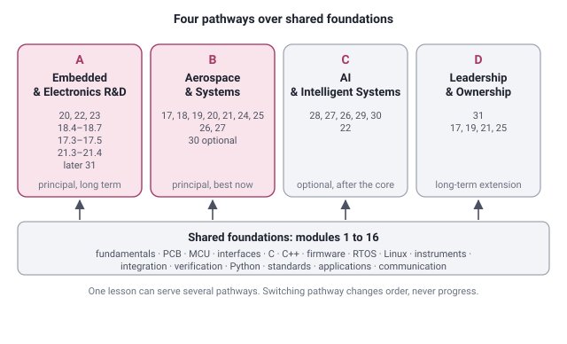
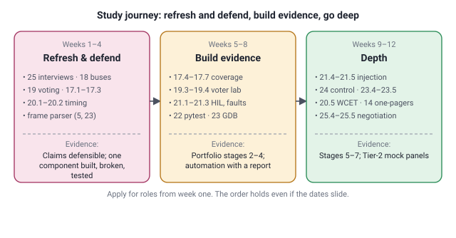

# Full curriculum map: 31 modules, four pathways, one study sequence

The authoritative written blueprint of AeroAca's learning content. It describes every module in the same shape so a learner can see what to study and why without getting lost. Topic-level detail (every topic with its Understand / Apply / Master explanation) is in [MODULE_TOPIC_BREAKDOWN.md](MODULE_TOPIC_BREAKDOWN.md); diagrams in [DIAGRAM_INDEX.md](DIAGRAM_INDEX.md); the personal route in [SUSHMITA_CAREER_SWITCH_GUIDE.md](SUSHMITA_CAREER_SWITCH_GUIDE.md); the day-by-day order in [STUDY_PLAN_30_60_90.md](STUDY_PLAN_30_60_90.md).

**Status words are exact.** *Published* means playable in the app on the current development branch. *Blueprint* means fully specified here and in the topic breakdown, not yet playable. A blueprint module is never shown in the app as complete. Completing any module is evidence of what was done at a stated depth; it is not a professional qualification and does not guarantee a job.

## How the map is organised

- **Foundations (1 to 16)** are shared by every pathway. Refresh them where the diagnostic finds a gap; do not relearn them.
- **Advanced modules (17 to 25)** are the approved 2.0 advanced syllabus, identifiers preserved (see [ADVANCED_MODULE_CROSSWALK.md](ADVANCED_MODULE_CROSSWALK.md)). They serve Pathways A and B.
- **Extensions (26 to 31)** add control, estimation, mathematics and AI, edge AI, autonomy and technical ownership. 26 and 27 serve Pathway B when the role needs them; 28 to 30 are Pathway C, optional, after the core; 31 is Pathway D.
- **Depth** is chosen by the learner per lesson: Understand (intuition, picture, worked example, guided exercise), Apply (calculations, code, independent exercises, labs), Master (failure modes, trade-offs, design briefs, the interview question). The "suggested depth" row below is advice per pathway, never a gate.
- **Sequence** is governed by the implementation plan's batches (P0 → P1 → P2), not by module number. The study plan turns that into weeks.

## Study sequence at a glance

| Phase | Modules (entry → depth) | Evidence produced |
|---|---|---|
| Refresh and defend (weeks 1 to 4) | 25; 18 (1553, 429, RS-422); 19 (voting); 17.1 to 17.3; 20.1 to 20.2; 5 and 23 via the frame parser | Claims defensible; one component built, broken, tested |
| Build the evidence (weeks 5 to 8) | 17.4 to 17.7; 19.3 to 19.4; 21.1 to 21.3; 20.3 to 20.4; 22; 23.1 to 23.3 | Portfolio stages 2 to 4; automation with a report |
| Depth (weeks 9 to 12) | 21.4 to 21.5; 17.8; 24; 23.4 to 23.5; 20.5; 14 one-pagers; 25.4 to 25.5 | Stages 5 to 7; Tier-2 panels |
| Long term | 26, 27 (Pathway B); 6, 9 (Pathway A); 28 to 30 (Pathway C); 31 (Pathway D) | Reviewed decisions on the shared product |

---

# Foundations (modules 1 to 16)

### 1. Electronic engineering fundamentals
- **Purpose.** Give every later module its physical ground: why a voltage is what it is at a given point, how a capacitor or a transistor behaves, what an ADC actually measures, where current returns.
- **Who it is for.** Everyone; for an engineer with bench experience it is a refresh taken where the diagnostic points.
- **Why it matters professionally.** Most "the board does weird things" faults are power, grounding or threshold faults. Hardware validation, R&D and integration roles test this on a whiteboard in the first ten minutes.
- **Prerequisites.** None; this is a starting point.
- **Learning objectives.** Compute currents, drops and dissipation with units; predict an RC response and a filter cutoff; choose a switching transistor and its gate drive; read logic thresholds and noise margins; read a power tree and measure a rail where it matters; size an ADC chain's resolution, reference and noise.
- **Major topics.** Circuit laws and Thévenin; passives, RC time constant, filters; diodes and transistors as switches; logic levels, open-drain, pull-ups; power trees, regulators, decoupling and bulk capacitance, load transients; op-amp sanity checks; ADC resolution, reference and noise; grounding, protection and ESD; signal conditioning (planned deepening); combinational and sequential logic timing (planned).
- **Real engineering application.** A rail that reads 3.31 V at the regulator and resets the load during bursts; an ADC that is noisy because of its reference; a sensor front end that saturates at temperature.
- **Interview relevance.** "Why does the load see less than the regulator produces?" "Size this pull-up." "How many bits of this ADC are real?"
- **Practical/lab relevance.** Divider and RC labs (Python), rail-sag interactive, multimeter and bench-supply lesson; LTspice sweeps and a KiCad schematic are planned (P0-4).
- **Pathways.** A, B, D core; C via module 28.
- **Suggested depth.** A: Master. B: Apply. C: Understand. D: Apply.
- **Status.** Published: 8 lessons (circuit laws, RC and filters, switches, logic levels, power tree, op-amps, ADC, grounding and protection); mission "The rail that sags". Blueprint: signal conditioning end to end, digital logic timing, calibration.

### 2. Circuit design, schematics and PCB
- **Purpose.** Move from reading a board to reviewing and designing one: schematic review, datasheet triage, part selection, layout, signal integrity, EMC and manufacturing outputs.
- **Who it is for.** Pathway A as a core design skill; B and D as reviewers.
- **Why it matters professionally.** R&D roles expect a schematic you drew and a board you brought up; integration roles expect you to find the fault in someone else's schematic before it ships.
- **Prerequisites.** Module 1; module 10 for the measurement side.
- **Learning objectives.** Review a schematic like a reviewer with a findings list; triage a datasheet to its five numbers; capture a schematic in KiCad with ERC clean; lay out a two-layer board with sensible returns and decoupling; produce Gerbers, drill and BOM; plan test points and DFM/DFT.
- **Major topics.** Schematic reading and review; datasheets and component selection; KiCad schematic capture; PCB layout, stack-up, returns and decoupling placement; signal integrity and termination; EMI/EMC pre-compliance basics; DFM, DFT and production test; LTspice and simulation validity.
- **Real engineering application.** A boot-strap pin left floating; an I2C level boundary nobody drew; a decoupling capacitor 2 cm from the pin.
- **Interview relevance.** "Review this schematic." "What would you check before sending this board to fabrication?"
- **Practical/lab relevance.** Schematic mission; KiCad project with ERC/DRC and manufacturing outputs (planned, P0-4b).
- **Pathways.** A core; B, D review depth.
- **Suggested depth.** A: Master. B: Apply. D: Apply.
- **Status.** Published: 2 lessons (schematic review, datasheet triage); mission "The schematic that almost shipped". Blueprint: KiCad capture, layout and SI, EMC basics, DFM/DFT, LTspice.

### 3. Microcontrollers, processors and ARM
- **Purpose.** Understand what the chip does from reset to a toggling pin: cores, memory, clocks, GPIO, interrupts, timers, DMA, watchdogs and low power.
- **Who it is for.** Everyone who touches firmware or a board with an MCU on it.
- **Why it matters professionally.** Bring-up ("no sign of life"), reset loops and timing faults all live here; every embedded panel asks about the NVIC and the clock tree.
- **Prerequisites.** Module 1 (logic levels, power); module 5 register bit masks for the Apply depth.
- **Learning objectives.** Choose an MCU from a part number; bring a dead board through power, reset, clock and boot pins; configure GPIO and the clock tree by hand; set interrupt priorities without surprises; use watchdogs and reset-cause registers; put a device to sleep and wake it.
- **Major topics.** MCU vs MPU vs SoC, Cortex-M/R/A, part numbers; power-reset-clock-boot order; first STM32 project and what the generator did; GPIO and the clock tree; interrupts and NVIC priorities; timers, PWM, input capture; DMA and buffer ownership; watchdogs and reset diagnosis; low-power modes and wake-up sources; Cortex-M exception model and fault registers (with 23).
- **Real engineering application.** A board that boots only with the debugger attached; a timer at twice the expected frequency; an interrupt that never fires because its clock is off.
- **Interview relevance.** "Board doesn't boot, what do you check first?" "Walk me through the clock tree to 84 MHz." "Why must a FreeRTOS interrupt priority sit below a certain level?"
- **Practical/lab relevance.** Clock-tree, NVIC, PWM and watchdog interactives; register arithmetic lab; two missions; a Nucleo board is the optional hardware path.
- **Pathways.** A core; B core at Apply; C, D Understand.
- **Suggested depth.** A: Master. B: Apply. C: Understand. D: Understand.
- **Status.** Published: 7 lessons; missions "Fresh board, no sign of life", "The board that resets every second". Blueprint: timers/PWM/input-capture implementation lab, DMA ownership lab, fault registers (shared with 23).

### 4. Communication interfaces
- **Purpose.** Read, decode and debug the buses every board uses, and know what each one is for.
- **Who it is for.** Everyone; integration and validation engineers most of all.
- **Why it matters professionally.** "The sensor never answers" and "the UART prints garbage" are the two most common integration faults; avionics adds 1553 and 429 (module 18).
- **Prerequisites.** Module 1 (logic levels, pull-ups); module 10 for the analyser.
- **Learning objectives.** Decode UART, SPI, I2C and CAN at the bit level; isolate a bus fault from pull-ups to firmware; explain arbitration, error frames and bus-off; read a 1553 word (module 18's first lesson lives here until 18 exists).
- **Major topics.** UART framing and baud tolerance; SPI modes and chip select; I2C addressing, ACK, clock stretching, pull-ups; CAN arbitration, error counters, bus-off; MIL-STD-1553B word and message (published); RS-232/422/485 and Modbus (with 18); Ethernet, TCP and UDP (with 18); driver implementation with timeouts and recovery (with 7); CAN FD and LIN (optional).
- **Real engineering application.** A sensor that NACKs because of a missing pull-up; a first byte shifted by one bit from the wrong SPI mode; a node that goes bus-off at power-up.
- **Interview relevance.** "Why does I2C need pull-ups and how do you size them?" "Which node wins arbitration?" "Describe a 1553 word."
- **Practical/lab relevance.** I2C, UART, SPI and CAN interactives; 1553 word lab; two missions.
- **Pathways.** All four; A and B at Master.
- **Suggested depth.** A: Master. B: Master. C: Apply. D: Understand.
- **Status.** Published: 5 lessons; missions "The sensor that never answers", "The UART that prints garbage". Blueprint: RS-485/Modbus, Ethernet/UDP (drafted), driver contract with error paths.

### 5. Embedded C
- **Purpose.** Write C that is correct on a microcontroller: fixed widths, pointers to hardware, memory layout, state machines, ring buffers, and code that survives review.
- **Who it is for.** Everyone writing or testing firmware; the first module to deepen for a tester moving to development.
- **Why it matters professionally.** Embedded C is the first thirty minutes of every embedded panel, and the frame-parser project (P0-1a) is the proof that you write and test it, not only read it.
- **Prerequisites.** None for the first lesson (register bit masks is a starting point); module 3 for pointers to hardware.
- **Learning objectives.** Read-modify-write a register safely; use fixed-width types and predict overflow; overlay a struct on a memory map; know where each variable lives; write a non-blocking state machine; write a ring buffer with a stated concurrency contract; build and test a C module from a clean checkout.
- **Major topics.** Register bit masks; functions, scope, static, const, arrays, structs; fixed-width integers, overflow, shifts; pointers to hardware and volatile; stack, heap, sections, linker basics; state machines; ring buffers; structs, packing, endianness, alignment; defensive C, static analysis, MISRA awareness (planned); unit testing without a framework (P0-1a); Git for a firmware project (planned).
- **Real engineering application.** An elapsed-time computation that fails after 49 days; a struct that is 12 bytes instead of 8; a parser that writes one byte past its buffer once a day.
- **Interview relevance.** "What does volatile do?" "Write a ring buffer." "Design the state machine for a debounced button." "Find the bug in this parser."
- **Practical/lab relevance.** Six CI-verified labs today (bits, elapsed, functions, memory, debounce, ring); the frame-parser lab with a shown and an unseen fault is the first P0 lesson.
- **Pathways.** All four; A at Master.
- **Suggested depth.** A: Master. B: Apply. C: Apply. D: Understand.
- **Status.** Published: 7 lessons, 6 labs. Blueprint: frame parser under test (P0-1a), defensive C and static analysis, coding-gym labs (CRC-8, memmove, frame pack), Git workflow.

### 6. Embedded C++
- **Purpose.** Use the parts of C++ that help on a microcontroller (RAII, classes as driver interfaces, templates for zero-cost abstraction) and know why the rest is restricted.
- **Who it is for.** Pathway A for roles that name C++; B and C as readers.
- **Why it matters professionally.** Many firmware teams are C++; interviewers ask "when would you not use exceptions or the heap on a flight computer?"
- **Prerequisites.** Module 5.
- **Learning objectives.** Use RAII for peripherals and critical sections; design a driver interface with classes and virtual dispatch or templates; test with mocks; state the resource trade-offs.
- **Major topics.** RAII and ownership; classes, references, constructors; interfaces, virtual dispatch vs templates; compile-time configuration; mocks and host tests; exceptions, heap and RTTI policy; debugging C++ on target.
- **Real engineering application.** A critical section that is never left on an early return; a driver tested on the host against a mock bus.
- **Interview relevance.** "What is RAII good for in firmware?" "Virtual or template for a driver interface?"
- **Practical/lab relevance.** Host-compiled guard and mock-driver labs (planned, P1-1).
- **Pathways.** A core where the role requires; others Understand.
- **Suggested depth.** A: Apply to Master. B, C, D: Understand.
- **Status.** Published: 1 lesson (RAII). Blueprint: classes and interfaces for drivers, templates, mocks, resource policy.

### 7. Firmware architecture and drivers
- **Purpose.** See firmware as layers: startup, HAL, BSP, drivers, application; choose the driver model; build a bootloader and recovery path; build and cross-compile reproducibly.
- **Who it is for.** Pathway A core; B for integration and recovery; D for release.
- **Why it matters professionally.** Field updates that brick, drivers that block, and "it works with the debugger attached" are architecture faults.
- **Prerequisites.** Modules 3 and 5.
- **Learning objectives.** Explain what runs before main; choose polling, interrupt or DMA with reasons; design an update with rollback; layer firmware with test seams; cross-build and run firmware checks in CI.
- **Major topics.** Reset vector to main; HAL/BSP/test seams; polling vs interrupt vs DMA; bootloaders, images, recovery; build systems, cross-compilation, firmware CI (with 5); GDB, JTAG, SWD (with 23).
- **Real engineering application.** A device that cannot be recovered after a failed update; a UART driver that blocks the control loop.
- **Interview relevance.** "What happens between reset and main?" "How do you make an update safe?"
- **Practical/lab relevance.** Startup interactive; layered firmware with a fake HAL and a bootloader path (planned, P0-1b/P0-2).
- **Pathways.** A core; B, D Apply.
- **Suggested depth.** A: Master. B: Apply. D: Apply.
- **Status.** Published: 3 lessons. Blueprint: HAL/BSP layering lab, build system and CI, bootloader built.

### 8. RTOS and real-time systems
- **Purpose.** The entry to real time: tasks, the scheduler, handoff from interrupts, and the classic faults (inversion, lost data). Module 20 deepens it.
- **Who it is for.** Everyone on firmware; B for timing arguments.
- **Why it matters professionally.** Priority inversion and ISR handoff are the two most asked RTOS questions; the pilot lesson on inversion is here.
- **Prerequisites.** Modules 3 (interrupts) and 5 (state machines).
- **Learning objectives.** Tell the three-task inversion story and bound the wait; hand data from an ISR to a task safely; describe task states and the scheduler's rules (20.1); compute utilisation and response time (20.2).
- **Major topics.** Priority inversion, inheritance and ceiling (published, 2.0 format); ISR-to-task handoff with queues; tasks, scheduler and tick (20.1, drafted); utilisation and response-time analysis (20.2, drafted); deadlock and lock ordering (20.6).
- **Real engineering application.** A sensor task late once a minute; a logger that stops printing when a float format is added.
- **Interview relevance.** "Explain priority inversion." "Mutex or semaphore?" "What does the scheduler do when the tick fires?"
- **Practical/lab relevance.** Inversion interactive; scheduler model lab (verified, awaiting publication); mission "The task that never runs".
- **Pathways.** A, B core; C, D Understand.
- **Suggested depth.** A: Master. B: Master. C, D: Understand.
- **Status.** Published: 2 lessons; mission. Blueprint: 20.1, 20.2, 20.6 publish here as the entry (shared `8;20`).

### 9. Embedded Linux and developer workflows
- **Purpose.** Boot chain, device tree, shell and processes, drivers at user and kernel level; plus the shared developer tooling (Git, build, debug) every engineer needs.
- **Who it is for.** Pathway A roles on Linux platforms; everyone for the tooling.
- **Why it matters professionally.** Legacy avionics platforms run Linux with real-time extensions; many embedded roles are Linux board support.
- **Prerequisites.** Module 7 (startup, bootloaders).
- **Learning objectives.** Explain the boot chain from bootloader to login; change a device-tree entry and see its effect; read logs and processes; write a user-space driver; know what a kernel module skeleton is; use Git properly on a firmware project.
- **Major topics.** Boot chain and device tree; shell, filesystem, processes, logs; BSP and cross-build; user-space drivers (sysfs, i2c-dev); kernel module skeleton; Xenomai and PREEMPT_RT positioning (with 20); Git branching, review, reproducible release.
- **Real engineering application.** A board that boots but has no console; a sensor on i2c-dev read from Python; a driver verified against an FPGA register map (with 23).
- **Interview relevance.** "What does the device tree do?" "User space or kernel space for this driver?"
- **Practical/lab relevance.** Emulator image boot and failure exercise (planned, P1-1).
- **Pathways.** A as the role requires; others Understand.
- **Suggested depth.** A: Apply. B, C, D: Understand.
- **Status.** Published: 1 lesson. Blueprint: shell and processes, device-tree change, user-space driver, Git workflow (P0 for Git, P1 for Linux).

### 10. Instrumentation and fault diagnosis
- **Purpose.** Measure without lying to yourself: multimeter and supply, oscilloscope and probing, logic analysers, DAQ, and a root-cause method.
- **Who it is for.** Everyone; hardware validation and integration roles above all.
- **Why it matters professionally.** The evidence in every debugging story comes from an instrument used correctly; the strongest existing skill of a bench engineer, to be told crisply.
- **Prerequisites.** Module 1 at Understand.
- **Learning objectives.** Choose range and understand burden voltage; set a current limit before power-up; probe without loading or aliasing; decode a bus with an analyser; capture raw data with settings and uncertainty; run a root-cause analysis to a cause you can change.
- **Major topics.** Multimeter and bench supply; oscilloscope probing, bandwidth, triggering, grounding; logic analysers and protocol decode; DAQ sampling and reporting (planned); power-reset-clock bring-up measurements; signal-integrity measurement; root-cause analysis and the five whys that matter.
- **Real engineering application.** A multimeter that averages a 20 ms dip into nothing; a 10× probe set to 1×; an intermittent fault chased to a connector.
- **Interview relevance.** "How do you probe a 50 MHz signal?" "Tell me about an intermittent fault you solved."
- **Practical/lab relevance.** Aliasing interactive; missions reuse bench readings (labelled simulated); real instruments at home or work are the hardware path.
- **Pathways.** All; A, B Master.
- **Suggested depth.** A: Master. B: Master. C: Apply. D: Understand.
- **Status.** Published: 4 lessons. Blueprint: DAQ sampling and reporting, SI measurement practice.

### 11. System integration and product engineering
- **Purpose.** From requirement to interface to integrated system: ICDs, bring-up checklists, integration faults, design reviews, change and release.
- **Who it is for.** Pathway B core; A for bring-up; D as the entry to ownership.
- **Why it matters professionally.** Systems integration roles are the near-term fit; this module is where "two boards, one bus, no agreement" is solved on paper before the lab.
- **Prerequisites.** Modules 4 and 10.
- **Learning objectives.** Write a bring-up checklist that gets used; write and review an ICD; isolate an integration fault to a side of the interface; run a design review; manage a change through to release.
- **Major topics.** Requirements and acceptance criteria; architecture and hardware/software partitioning; interface control documents; board bring-up; integration faults; design reviews and decision records; change, configuration and release (with 31).
- **Real engineering application.** Two teams with different byte orders; a bring-up that skipped the current-limit step; a change with no impact analysis.
- **Interview relevance.** "What goes in an ICD?" "Design a bring-up checklist." "How do you run a design review?"
- **Practical/lab relevance.** Traceability interactive (with 12); the portfolio product's requirements and ICD stages.
- **Pathways.** B core; A, D Apply to Master.
- **Suggested depth.** A: Apply. B: Master. D: Master.
- **Status.** Published: 2 lessons; mission "Two boards, one bus, no agreement". Blueprint: requirements writing, architecture and partitioning, reviews and decision records, release and change.

### 12. Verification, reliability and qualification
- **Purpose.** Test design a reviewer can trust, traceability, what SIL and HIL each prove, FMEA; the entry to module 17 (DO-178C practice) and 21 (HIL and fault injection).
- **Who it is for.** Everyone; V&V specialisation starts here.
- **Why it matters professionally.** Every role tests "write a test for this requirement"; V&V and integration roles test the rest.
- **Prerequisites.** Module 11 at Understand.
- **Learning objectives.** Write a test case with a measurable pass criterion; trace requirements to tests both ways; say what SIL, PIL and HIL each prove and do not; run an FMEA to a mitigation and a test.
- **Major topics.** Test-case design and traceability; host unit, integration and regression tests (with 5); SIL/PIL/HIL and model limits; FMEA and reliability; environmental qualification planning (with 21); jigs and production test (with 2).
- **Real engineering application.** A requirement nobody could test; a timing requirement verified only on the host; an FMEA that found the single-point failure.
- **Interview relevance.** "Write a test for 'the device shall respond within 10 ms'." "What does HIL prove that SIL does not?"
- **Practical/lab relevance.** Traceability and FMEA interactives; portfolio detection harness with a known failing case.
- **Pathways.** All; B, D Master.
- **Suggested depth.** A: Apply. B: Master. C: Apply. D: Master.
- **Status.** Published: 3 lessons; mission "The requirement nobody could test". Blueprint: host test harness with negative cases (P0-1a), environmental planning.

### 13. Python for engineering and test automation
- **Purpose.** Python as the test-bench language: instruments, serial, logs; the entry to module 22 (advanced automation).
- **Who it is for.** Everyone; test automation roles specifically.
- **Why it matters professionally.** "Python automation" on a profile invites "show me the architecture"; this module and 22 make that answerable.
- **Prerequisites.** None technical; module 4 for serial.
- **Learning objectives.** Talk to an instrument with SCPI over PyVISA; read and write a serial port with framing and timeouts; parse logs and write a report; handle bytes and strings correctly.
- **Major topics.** Python engineering foundations (bytes, files, exceptions); SCPI and PyVISA; serial automation and test logs; CSV, statistics and plots (with 22); `pytest` (22).
- **Real engineering application.** A flaky test fixed by a protocol-level wait instead of a sleep; an instrument that returns the wrong unit.
- **Interview relevance.** "How would you automate this measurement?" "Why is `time.sleep` the wrong fix?"
- **Practical/lab relevance.** SCPI console interactive; bytes/str and request-reply labs; mission "The flaky automated test".
- **Pathways.** All; A, B, C at Apply.
- **Suggested depth.** A: Apply. B: Apply. C: Master. D: Understand.
- **Status.** Published: 2 lessons, 2 labs, mission. Blueprint: Python foundations lesson, reports and statistics (shared with 22).

### 14. Safety and standards awareness
- **Purpose.** Know what each standard is for, which applies where, and how to speak about them without claiming compliance.
- **Who it is for.** Pathway B core; everyone at Understand.
- **Why it matters professionally.** Avionics panels screen on DO-178C and DO-254 vocabulary; the honest answer distinguishes "worked under" from "certified to".
- **Prerequisites.** Module 12.
- **Learning objectives.** State the scope of DO-178C, DO-254, DO-160, ARP4754A/ARP4761, ISO 26262, IEC 62304/60601, IEC 61508; say what a level or class changes; avoid "the standard requires" without a clause.
- **Major topics.** Avionics and automotive standards scope; medical and industrial scope; DO-254, MIL-STD-461, MIL-STD-810, AS9100 one-pagers (planned); the standards claim ledger (edition, clause, reviewer).
- **Real engineering application.** A CV that says "Level A" and a panel that asks what MC/DC is; a test report that claims compliance from a synthetic test.
- **Interview relevance.** "What changes between Level C and Level A?" "What is DO-160 for?"
- **Practical/lab relevance.** Standards map interactive; no lab by design.
- **Pathways.** B core; others Understand.
- **Suggested depth.** B: Apply. A, C, D: Understand.
- **Status.** Published: 2 lessons. Blueprint: four one-pagers, claim ledger.

### 15. Applications across industries
- **Purpose.** Transfer: the same skills in UAV, automotive, medical, industrial, FPGA and vision contexts, and how to talk about transfer honestly.
- **Who it is for.** Anyone applying outside the industry they trained in.
- **Why it matters professionally.** Cross-industry moves are where the ₹ step often is; the vocabulary differs more than the work.
- **Prerequisites.** Any three foundation modules.
- **Learning objectives.** Map a skill to another sector's words; name the sector's standards and buses; avoid overclaiming.
- **Major topics.** Same skills, different industries; sector notes on interview questions; optional orientation lessons per domain (demand-led).
- **Real engineering application.** A CAN servo in a drone and a CAN ECU in a car; a 1553 bus and a Modbus loop.
- **Interview relevance.** "You come from avionics; why automotive?"
- **Practical/lab relevance.** None by design; the sector notes attach to interview questions.
- **Pathways.** All, Understand.
- **Suggested depth.** Understand.
- **Status.** Published: 1 lesson. Blueprint: domain orientation lessons only on demand (P2).

### 16. Engineering communication and interviews
- **Purpose.** Make the work visible without inflating it: portfolio presentation, debugging stories, coding basics, notice and negotiation; module 25 extends it for experienced engineers.
- **Who it is for.** Everyone, from day one.
- **Why it matters professionally.** Interviews are where the other fifteen modules are judged.
- **Prerequisites.** None.
- **Learning objectives.** Present a project with evidence, decision and outcome; tell a debugging story; separate training from employment history; answer coding basics; negotiate truthfully (25).
- **Major topics.** Presenting a portfolio project honestly; telling a debugging story; coding interviews and negotiation (with 25); career gap, contract role, ownership and metrics claims (25).
- **Real engineering application.** The same project told as "I owned the test campaign" versus "I led the programme".
- **Interview relevance.** All of it.
- **Practical/lab relevance.** Timed mock-interview mode; interview bank with rubrics.
- **Pathways.** All, Master.
- **Suggested depth.** Master for everyone.
- **Status.** Published: module 25 lessons 25.1 to 25.5 in two lessons (`career-gap-contract-and-ownership`, `claims-metrics-and-negotiation`), with four interview questions; the timed mock is day 29 of the journey.

---

# Advanced modules (17 to 25): the approved 2.0 syllabus, identifiers preserved

### 17. Verification the DO-178C way
- **Purpose.** Do verification the way certified avionics does it, on a synthetic product you can show: objectives and levels, requirements-based tests, structural coverage and MC/DC, traceability, problem reports, change impact, audits.
- **Who it is for.** Pathway B; Pathway A for the test lessons; D for the argument.
- **Why it matters professionally.** Avionics V&V roles in the target band ask for exactly this practice; it also makes "worked under DO-178B" a defensible claim.
- **Prerequisites.** Module 12; module 5 for the coverage lab.
- **Learning objectives.** State what changes per level; split a requirement into testable low-level requirements; write normal and robustness tests; run coverage on a host build and do MC/DC by hand; trace both ways and run a problem report; do a change impact analysis; describe SOI audits and the DO-178C supplements.
- **Major topics.** 17.1 objectives and levels A to E; 17.2 HLR, LLR, derived requirements, ARP4754A/4761 concepts above them; 17.3 requirements-based testing; 17.4 traceability and the problem-report lifecycle; 17.5 statement, decision, MC/DC with a gcov lab; 17.6 change impact analysis; 17.7 dead, deactivated and unreachable code; 17.8 B to C, DO-330/331/332/333, SOI 1 to 4; 17.9 DO-254, MIL-STD-461/810, AS9100 one-pagers; mission "The coverage gap before the audit".
- **Real engineering application.** A traceability matrix at 100 % with an objective still unmet; a one-line fix whose re-verification costs a week.
- **Interview relevance.** "Level A versus Level C?" "Do MC/DC for this decision." "What is in an ATP versus a QTP?"
- **Practical/lab relevance.** `c-coverage` lab (gcc/gcov on a 60-line module with tests and one unreachable branch); portfolio track 2 stage 4.
- **Pathways.** B, D core; A for 17.3 to 17.5.
- **Suggested depth.** B: Master. D: Master. A: Apply.
- **Status.** Published: four lessons covering 17.1 to 17.6 (levels and objectives; HLR, LLR and requirements-based testing; structural coverage and MC/DC with the `c-mcdc` lab; traceability, problem reports and change impact). Blueprint: 17.7 dead and deactivated code beyond the coverage-gap analysis, 17.8 and 17.9 one-pagers. Diagrams: DO-178C levels, V-model traceability, MC/DC pairs.

### 18. Avionics data buses and telemetry
- **Purpose.** The buses of aircraft, UAVs and industrial systems from the wire up: MIL-STD-1553B, ARINC 429, RS-232/422/485 and Modbus, telemetry packet design, Ethernet and UDP.
- **Who it is for.** Pathways A and B; D as reader.
- **Why it matters professionally.** On the skills line of most avionics job descriptions; decoding a word by hand is what turns "familiar with" into "has used".
- **Prerequisites.** Module 4 (UART, CAN); module 5 (fixed-width integers).
- **Learning objectives.** Build and decode a 1553 word; walk a 1553 message with its timing and list the no-response causes; encode and decode ARINC 429 words; explain RS-422 versus RS-485 and frame a serial link with CRC; design and parse a telemetry packet with `struct`; choose UDP or TCP for telemetry.
- **Major topics.** 18.1 1553 word and message (published); 18.2 bus controller, remote terminals, monitor, schedules and faults; 18.3 ARINC 429 word, labels, SSM, speeds, topology; 18.4 RS-232/422/485, termination, failsafe bias, CRC framing; 18.5 telemetry packet design and parsing; 18.6 Ethernet, TCP and UDP for embedded; 18.7 Modbus RTU; mission "The remote terminal that answers late".
- **Real engineering application.** A terminal silent on one command because of an illegal word count; a mis-terminated RS-485 line; a UDP telemetry stream with a sequence gap.
- **Interview relevance.** "Describe a 1553 word." "Why does a terminal not respond?" "ARINC 429 label and SSM?"
- **Practical/lab relevance.** Labs: `c-1553-word` (published), `c-crc16` and `py-udp-echo` (drafted and verified), `py-1553-decode`, `py-a429`, `py-telemetry-parse` (planned).
- **Pathways.** A, B core; D Understand.
- **Suggested depth.** A: Apply. B: Master. D: Understand.
- **Status.** Published: five lessons (1553 word and message; 1553 controller, terminals and faults with the monitor-log lab; ARINC 429; RS-422 and RS-485 with CRC; telemetry packets with struct). Blueprint: Ethernet and TCP/UDP for embedded engineers, Modbus RTU detail. Diagrams: 1553 word, 1553 message timing, ARINC 429 word.

### 19. Redundant flight-control architectures
- **Purpose.** Why flight-control systems are redundant, how channels exchange data and vote, how failures are detected and isolated, and how a cross-channel link is tested.
- **Who it is for.** Pathway B core; D for the architecture argument.
- **Why it matters professionally.** The redundancy and cross-channel-link experience on a flight-control programme becomes defensible only when you can draw the architecture and explain the voter.
- **Prerequisites.** Modules 4, 11; module 8 for timing.
- **Learning objectives.** Explain fail-operational, fail-passive and fail-safe; compare duplex, triplex and quad; implement a voter with miscompare and persistence; design the test matrix for a cross-channel link; explain channel synchronisation and start-up.
- **Major topics.** 19.0 the flight-control system as a whole (sensors, computers, actuators, power); 19.1 why redundancy, common-mode faults, dissimilarity; 19.2 channel architectures; 19.3 cross-channel exchange, voting, monitors, isolation (voter lab); 19.4 testing a cross-channel link: integrity, latency, dropout, failover; 19.5 synchronisation and frame alignment; mission "Channel B disagrees".
- **Real engineering application.** Two channels disagreeing by a persistent offset; a channel isolated after N frames of silence; a reset that desynchronised the frames.
- **Interview relevance.** "Why do redundant channels exchange data?" "What is voted and what happens on disagreement?"
- **Practical/lab relevance.** `c-voter` lab (planned): three channels, stuck/late/corrupt injection, detection and isolation times printed; portfolio track 2 stage 3.
- **Pathways.** B core; D Master; A Understand.
- **Suggested depth.** B: Master. D: Master. A: Understand.
- **Status.** Published: three lessons (why redundancy; voting, monitors and failover with the `c-voter` simulation; testing a cross-channel link). Blueprint: dedicated channel-synchronisation lesson (covered briefly in the link-test lesson). Diagrams: redundant channels, fault-injection flow.

### 20. Deterministic timing and real-time analysis
- **Purpose.** Prove timing instead of hoping: tasks and the tick, utilisation and response time, frame-based executives, shared-memory handshakes, measured WCET, deadlock.
- **Who it is for.** Pathways A and B.
- **Why it matters professionally.** "Sub-millisecond deterministic" is a claim only if you can say how it was measured and bounded; every real-time panel asks why 80 % CPU load proves nothing.
- **Prerequisites.** Module 8 (entry lessons shared `8;20`); module 3 interrupts.
- **Learning objectives.** Describe task states and what the scheduler does at the tick; compute the rate-monotonic bound and iterate a response time with blocking; design a minor/major frame executive and detect overruns; implement a shared-memory handshake and measure its latency; measure WCET and jitter on target; prevent deadlock with lock ordering.
- **Major topics.** 20.1 tasks, scheduler, tick (drafted); 20.2 deadlines, utilisation, response time (drafted); 20.3 frame-based executives and rate groups; 20.4 shared memory and dual-port RAM handshakes; 20.5 WCET and jitter measurement; 20.6 deadlock, lock ordering, Xenomai and PREEMPT_RT in one page; mission "The 10 ms frame that overran once an hour".
- **Real engineering application.** A logger that starves when a float format is added; a frame that overruns once an hour; a race in a flag-based handshake.
- **Interview relevance.** "Is this task set schedulable?" "Why does average CPU load not prove deadlines?" "How did you measure sub-millisecond latency?"
- **Practical/lab relevance.** `c-sched` scheduler model (verified), `c-frame-exec`, `c-dpram-handshake` (planned); GPIO-and-scope measurement on a board.
- **Pathways.** A, B core.
- **Suggested depth.** A: Master. B: Master. C, D: Understand.
- **Status.** Published: six lessons (tasks and the tick with `c-sched`; deadlines and response time; frame-based executives with `c-frame-exec`; shared memory with `c-dpram`; WCET and jitter; deadlock and lock ordering). Blueprint: the mission "The 10 ms frame that overran once an hour". Diagrams: task states, response-time timeline, frame executive.

### 21. HIL, test benches and fault injection
- **Purpose.** Build and use benches that prove things: HIL architecture, bench design from an ICD, FMEA to fault-injection tests, protocol and power fault injection.
- **Who it is for.** Pathways B and D; A for fault injection on its own product.
- **Why it matters professionally.** Validation and integration roles ask "how did you test failover" and "what did you inject"; this module makes the answer concrete.
- **Prerequisites.** Modules 12, 11; module 22 for the injector.
- **Learning objectives.** Draw an HIL architecture and say what is real; design a bench for a given LRU; derive fault-injection tests from an FMEA; inject CRC, timing, stuck-at and babbling faults into a link and assert detection; plan power and environmental fault tests.
- **Major topics.** 21.1 HIL architecture: plant, I/O, real-time target, fault insertion; SIL/PIL/HIL compared; 21.2 bench design from an ICD, instruments, electronic load, safety interlocks; 21.3 FMEA to fault-injection matrix; 21.4 protocol fault injection with the Python injector; 21.5 power and environment faults, MIL-STD-810 and 461 as context; mission "The fault the bench never injected".
- **Real engineering application.** A failover tested only with a pulled cable; a bus babbling node nobody simulated.
- **Interview relevance.** "Describe the HIL you used and what was simulated." "How would you inject a late frame?"
- **Practical/lab relevance.** `py-fault-inject` (planned) against the simulated link; portfolio track 2 stage 5.
- **Pathways.** B, D core; A Apply.
- **Suggested depth.** B: Master. D: Master. A: Apply.
- **Status.** Published: two lessons (HIL architecture and bench design; FMEA to fault injection with the `py-fault-inject` simulation). Blueprint: 21.5 power and environment faults, the mission "The fault the bench never injected". Diagrams: HIL architecture, fault-injection flow.

### 22. Advanced Python test automation
- **Purpose.** Turn Python from scripts into a test framework you can draw: binary data, serial and instruments, logs to evidence, `pytest`, architecture, reproducibility.
- **Who it is for.** All pathways; test automation roles specifically.
- **Why it matters professionally.** "Architected an automation suite" invites "draw it"; this module is the drawing.
- **Prerequisites.** Module 13 (shared `13;22`).
- **Learning objectives.** Parse framed binary records with `struct` and check CRCs; drive serial and instruments without sleep-driven flakiness; parse logs with regex and produce a report; write `pytest` fixtures, parametrisation and markers for hardware; describe a framework's layers and measure the time it saves honestly; make runs reproducible.
- **Major topics.** 22.1 `struct`, endianness, bit fields, checksums; 22.2 serial and instruments, timeouts, retries; 22.3 logs to evidence, CSV, statistics, plots; 22.4 `pytest` for hardware tests, reports; 22.5 framework architecture (drivers, protocol, cases, reporting); 22.6 reproducible runs (seeds, versions, environments).
- **Real engineering application.** A telemetry log with a sequence gap found by a test; a regression run that reports in a table a reviewer reads.
- **Interview relevance.** "Draw the architecture of your automation suite." "How did you measure the 60 %?"
- **Practical/lab relevance.** `py-struct-frames`, `py-log-report`, `py-pytest-suite` (planned); `pytest` added to the CI labs job; portfolio track 2 stage 6.
- **Pathways.** All; C Master.
- **Suggested depth.** A: Apply. B: Apply. C: Master. D: Understand.
- **Status.** Published: three lessons (logs to evidence with `py-log-report`; pytest for hardware tests, no lab because pytest is not in the CI labs job; architecture of a test framework with `py-bench-framework`). Blueprint: dedicated struct and serial lessons beyond module 13 and the telemetry lesson. Diagram: test framework layers.

### 23. Production debugging on target
- **Purpose.** Debug on the chip, not by printf: the probe, GDB, HardFault analysis, ARM9 versus Cortex-M, verifying a driver against a register specification.
- **Who it is for.** All pathways; A core.
- **Why it matters professionally.** "Fault isolation with ST-Link and J-Link" becomes a skill the moment you can decode a fault register to a line.
- **Prerequisites.** Modules 3, 5, 7.
- **Learning objectives.** Explain what the debug probe does; set breakpoints and watchpoints and read peripherals under GDB; decode CFSR/HFSR and the stacked PC to a source line; contrast ARM9 (VIC, MMU, caches) with Cortex-M; verify a driver against a register map and an FPGA with a test against a mock.
- **Major topics.** 23.1 SWD/JTAG and the debug access port, ST-Link vs J-Link; 23.2 GDB on target; 23.3 HardFault analysis with the fault-decode lab; 23.4 ARM9 vs Cortex-M; 23.5 driver against a register spec and an FPGA, ICD for the register map; mission "HardFault after the firmware update".
- **Real engineering application.** An imprecise bus fault from a stack overflow; a driver that worked on the old FPGA image and not the new one.
- **Interview relevance.** "How do you find the line that caused a HardFault?" "Breakpoint or watchpoint?"
- **Practical/lab relevance.** `c-fault-decode` (synthetic fault registers), `c-regmap-test` (planned); a real HardFault on a Nucleo as the board path.
- **Pathways.** A core; B, C, D Apply.
- **Suggested depth.** A: Master. B: Apply. C: Apply. D: Understand.
- **Status.** Published: two lessons (debug probe and GDB; HardFault analysis with the synthetic-capture `c-fault-decode` lab). The frame-parser lesson `building-a-frame-parser-and-breaking-it` sits in module 5 with three labs. Blueprint: 23.4 ARM9 versus Cortex-M, 23.5 driver against a register spec. Diagrams: debug chain, HardFault decode flow.

### 24. Flight-control systems orientation
- **Purpose.** The flight-control loop as a whole: sensors, estimation, control laws, actuators, modes; PID without mystery; what the flight computer's software looks like from outside.
- **Who it is for.** Pathway B; C as the entry to 26 and 27.
- **Why it matters professionally.** Integration engineers on flight-control programmes are expected to speak the control vocabulary even when they do not design the laws.
- **Prerequisites.** Modules 1 and 13; module 19.0.
- **Learning objectives.** Draw the loop with sensors, estimator, controller, actuators; explain what P, I and D each fix and break; implement a discrete PID and show a step response; describe rate groups, monitors, built-in test and data recording from the outside.
- **Major topics.** 24.1 the control loop on an aircraft or UAV; 24.2 PID with a step-response lab; 24.3 the flight computer's software from outside.
- **Real engineering application.** An actuator loop that oscillates after a gain change; a mode transition that the test rig never exercised.
- **Interview relevance.** "Explain PID to a new graduate." "What does a flight-control computer do every 10 ms?"
- **Practical/lab relevance.** `py-pid-step` (planned).
- **Pathways.** B core; C entry.
- **Suggested depth.** B: Apply. C: Apply. A, D: Understand.
- **Status.** Published: one lesson (control loop and PID with the simulated `py-pid` lab). Blueprint: 24.3 the flight computer's software from outside. Diagram: control loop with PID.

### 25. Interviews for experienced engineers
- **Purpose.** The questions a two-to-four-year engineer gets that a graduate does not: the gap, the contract role, "what did you own", metrics claims, notice and negotiation; a mock panel bank drawn from modules 17 to 24.
- **Who it is for.** Everyone switching roles with experience.
- **Why it matters professionally.** These are asked in the first ten minutes of every interview and decide whether the technical hour happens.
- **Prerequisites.** Module 16.
- **Learning objectives.** Explain a gap or a contract role truthfully in under a minute; answer "what did you own" as a verification or integration engineer; audit your own claims with the explain/demonstrate/substantiate test; state a metric with how it was measured; negotiate from facts.
- **Major topics.** 25.1 career gap or contract role; 25.2 "what did you own"; 25.3 auditing your own claims; 25.4 metrics claims; 25.5 notice period, CTC and negotiation; timed mock panel at Tier 2.
- **Real engineering application.** The same regression suite described as "architected" and as "wrote and maintained".
- **Interview relevance.** All of it.
- **Practical/lab relevance.** None; rehearsal with the timed mock mode.
- **Pathways.** All, Master.
- **Suggested depth.** Master.
- **Status.** Blueprint (P0-5; shared `16;25`).

---

# Extensions (26 to 31)

### 26. Control engineering and flight dynamics
- **Purpose.** Depth beyond orientation: plant and feedback, PID with anti-windup, stability and sample-time limits, flight dynamics and frames, model-based design concepts with an open alternative.
- **Who it is for.** Pathway B roles that touch control laws; Pathway C.
- **Why it matters professionally.** Control-law integration and HIL of control software need this vocabulary at Apply depth.
- **Prerequisites.** Module 24; module 28 mathematics.
- **Learning objectives.** Model a first-order plant and close a loop; add anti-windup and explain why; relate sample time to stability; describe body and earth frames and the basic flight-dynamics quantities; compare a Simulink workflow with a Python one.
- **Major topics.** Plant models and feedback; PID tuning, anti-windup, derivative filtering; stability margins and sample time; flight dynamics basics and frames; model-based design, code generation, DO-331 vocabulary.
- **Real engineering application.** A loop stable in simulation and oscillating at a slower sample rate; integrator wind-up after a saturation.
- **Interview relevance.** "What does sample time do to stability?" "What is anti-windup?"
- **Practical/lab relevance.** Python plant and loop labs (planned); open alternative to licensed tools.
- **Pathways.** B, C.
- **Suggested depth.** B: Apply. C: Apply.
- **Status.** Blueprint (P1-3).

### 27. Signals, navigation and estimation
- **Purpose.** From raw sensor to trusted state: IMU, GNSS and air data with their fault models, filtering and fusion, Kalman predict and update.
- **Who it is for.** Pathways B and C.
- **Why it matters professionally.** Navigation and sensor-fusion vocabulary appears in UAV and flight-control integration roles; estimation is the bridge to AI-enabled systems.
- **Prerequisites.** Module 28 mathematics; module 24.
- **Learning objectives.** Describe each sensor's errors and failure modes; design a complementary filter; implement a one-dimensional Kalman filter and interpret residuals; detect divergence and dropout.
- **Major topics.** Digital filtering and aliasing (with 1); IMU, GNSS, air-data sensors and fault models; sensor fusion basics; state estimation and Kalman fundamentals; residuals, lag, divergence.
- **Real engineering application.** A GNSS dropout masked by the IMU for ten seconds; a bias that walks the estimate.
- **Interview relevance.** "Explain a Kalman filter without equations, then with them."
- **Practical/lab relevance.** Known-truth Python labs with noise, bias and dropout (planned).
- **Pathways.** B, C.
- **Suggested depth.** B: Apply. C: Master.
- **Status.** Blueprint (P1-3). Diagram: Kalman predict/update loop.

### 28. Engineering mathematics and AI foundations
- **Purpose.** The mathematics the later modules assume (vectors, matrices, probability, sampling, least squares) and the honest basics of machine learning (baselines, splits, leakage).
- **Who it is for.** Pathway C; B before 26 and 27.
- **Why it matters professionally.** Without it, estimation and ML are recipes; with it they are engineering.
- **Prerequisites.** Module 13.
- **Learning objectives.** Use vectors and matrices for state and measurement; reason about noise with probability; sample and fit by least squares; set up an ML problem with a baseline and a clean split.
- **Major topics.** Vectors and matrices; probability and noise; sampling and aliasing; least squares and fitting; ML fundamentals, baselines, validation, leakage.
- **Real engineering application.** A calibration fit that overfits five points; a model that "works" because the test set leaked.
- **Interview relevance.** "Why do you need a baseline?" "What is a covariance matrix telling you?"
- **Practical/lab relevance.** Python notebooks as labs (planned).
- **Pathways.** C core; B supporting.
- **Suggested depth.** C: Apply. B: Understand to Apply.
- **Status.** Blueprint (P1-3 mathematics, P2-1 ML).

### 29. Edge AI and intelligent products
- **Purpose.** AI where it meets the hardware: TinyML and quantisation, anomaly detection and predictive maintenance, embedded vision, AI-assisted firmware and tests, and the assurance questions, each labelled established, emerging or research.
- **Who it is for.** Pathway C; optional, after the core.
- **Why it matters professionally.** Intelligent sensing and predictive maintenance are growing in aerospace and industrial electronics; the engineer who can measure what a model costs on a Cortex-M is rare.
- **Prerequisites.** Modules 5, 13, 28; module 27 for anomaly detection.
- **Learning objectives.** Quantise and deploy a small model and measure memory and latency; build an anomaly detector with a non-ML baseline and a false-alarm analysis; set up an embedded vision pipeline and know where a neural model fits; use AI assistants for drivers and tests and verify their output; state why DO-178C does not cover learned behaviour.
- **Major topics.** TinyML, quantisation, inference budgets (established); anomaly detection and predictive maintenance (emerging); embedded vision (established tools, evolving); AI-assisted firmware, generated tests and analysis (emerging); verification of AI-enabled safety-critical systems, runtime assurance (research).
- **Real engineering application.** A keyword model that fits in 64 kB; a bearing-fault detector with a tunable false-alarm rate.
- **Interview relevance.** "What does quantisation cost?" "Why can't you certify a neural network like C code?"
- **Practical/lab relevance.** Public or synthetic data labs with held-out baselines (planned).
- **Pathways.** C; B for vision and assurance.
- **Suggested depth.** C: Master. B: Understand.
- **Status.** Blueprint (P2-1, P2-2). Diagram: edge-AI pipeline.

### 30. Autonomy and simulation engineering
- **Purpose.** Autonomous-system fundamentals (perception, planning, control, safety monitors), ROS 2 and flight-stack simulation, digital twins and simulation-based engineering, with explicit limits.
- **Who it is for.** Pathways B and C; optional.
- **Why it matters professionally.** UAV companies increasingly want engineers who can run and read a simulation stack; the limits of simulation are as important as its use.
- **Prerequisites.** Modules 9, 26, 27; module 29 for AI assurance.
- **Learning objectives.** Describe an autonomy stack and where the safety monitor sits; run a PX4 or ArduPilot simulation and inject a fault; explain ROS 2 topics, QoS and frames; say what a digital twin is and is not and how it is validated.
- **Major topics.** Autonomy stack and safety monitors; ROS 2 fundamentals; PX4/ArduPilot simulation; digital twins and model validation; simulation-based engineering and its limits; MATLAB/Simulink concepts (with 26).
- **Real engineering application.** A simulated dropout that the real radio handles differently; a twin calibrated to one flight and wrong on the next.
- **Interview relevance.** "What does simulation prove?" "Where does the safety monitor sit?"
- **Practical/lab relevance.** Pinned, isolated simulation labs (planned).
- **Pathways.** B, C.
- **Suggested depth.** C: Apply. B: Understand.
- **Status.** Blueprint (P2-2). Diagram: autonomy stack.

### 31. Engineering leadership and technical ownership
- **Purpose.** Grow from engineer to someone who owns technical decisions: stakeholders and problems, feasibility and trade-offs, BOM and cost, reliability and lifecycle, reviews, roadmaps, release ownership, through reviewed work on the shared product.
- **Who it is for.** Pathway D; anyone two to five years out who wants the next role to be a lead or owner role.
- **Why it matters professionally.** Technical leads and product owners are made of decision records, reviews and follow-through, not titles; this module produces those artefacts.
- **Prerequisites.** Modules 11, 12, 16; a reviewed portfolio product.
- **Learning objectives.** Turn a synthetic stakeholder brief into requirements with acceptance criteria; run a feasibility study with competing designs and a decision record; build a BOM and cost roll-up with dated assumptions; write a risk register and a service plan; run a design review and a roadmap discussion; own a controlled release and its change.
- **Major topics.** Customer discovery and stakeholder problems; feasibility, partitioning, trade-offs and decision records; BOM, cost and supply risk; reliability, maintainability and lifecycle; reviews, roadmaps, prioritisation, communication; product integration, qualification and release ownership.
- **Real engineering application.** A feature that costs more in test than it earns; a part with a 52-week lead time found at the BOM stage.
- **Interview relevance.** "Tell me about a decision you owned and what it cost."
- **Practical/lab relevance.** Extends the portfolio product: brief, competing designs, BOM, review, release (planned).
- **Pathways.** D core; A, B as they grow.
- **Suggested depth.** D: Master. A, B: Apply.
- **Status.** Blueprint (P2-3). Diagram: product lifecycle and ownership loop. No completion of this module confers a title.

---

## Portfolio: the one product seen from four directions

| Track | Stages | Pathway view |
|---|---|---|
| STM32 sensor monitor (published) | 7 stages, 19 deliverables, in-browser fault-injection lab, Build-it labs | A: build and debug it |
| Redundant telemetry link, verified the DO-178C way (blueprint) | 1 requirements and ICD · 2 framed link with CRC · 3 three-channel voter with fault injection · 4 requirements-based tests, coverage, traceability · 5 fault-injection campaign · 6 `pytest` automation suite with report · 7 timing analysis and bench design | B: architecture, buses, redundancy, verification argument |
| Later layers (blueprint) | Estimation and an edge model with cost measured (C); requirements from a brief, decision records, BOM, risk register, roadmap, a review you run (D) | C and D |

Everything is synthetic and labelled as training; simulation and hardware evidence are recorded separately; no portfolio stage is employer material.
